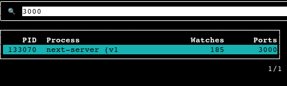
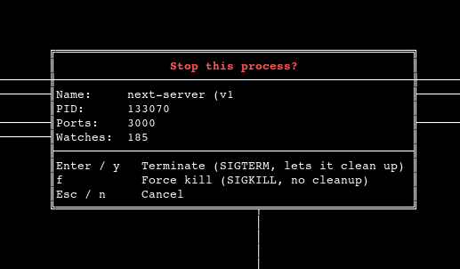

<p align="center">
  
</p>

<h1 align="center">watchtop</h1>

<p align="center">
  <b>Who is using up your file watchers?</b><br>
  Find out in seconds, and fix <i>"System limit for number of file watchers reached"</i>.
</p>

<p align="center">
  
  
  
  
</p>

**watchtop** is a Linux terminal tool that shows which programs are using up your file watchers.

Your editor, your dev server and your sync apps all ask Linux to tell them when a file changes. Each request is called a **watch**, and Linux only allows so many of them. When the limit is reached, apps crash or stop reloading, and the error does not say who is responsible.

watchtop shows you **who** is using the watches, **whether the number keeps growing**, and lets you **stop the culprit safely**, all in one live dashboard.


---

## Table of Contents
- [Why watchtop?](#why-watchtop)
- [How it works](#how-it-works)
- [Features](#features)
- [Installation](#installation)
- [How to use it](#how-to-use-it)
- [Keyboard controls](#keyboard-controls)
- [Stopping a process (safely)](#stopping-a-process-safely)
- [Security and safety](#security-and-safety)
- [Tests done so far](#tests-done-so-far)
- [Known limitations](#known-limitations)
- [Roadmap](#roadmap)
- [Contributing](#contributing)
- [License](#license)

---

## Why watchtop?

**inotify** is the Linux feature that lets programs ask: *"tell me when this file or folder changes."* Each request is a **watch**, and the kernel limits how many watches one user can have:

```
/proc/sys/fs/inotify/max_user_watches
```

Dev tools use many watches: VS Code, Vite, webpack, Next.js, nodemon, Syncthing, Dropbox and build systems. When the limit is reached, apps crash, fail to start, or silently stop reloading files, and the error message does not say **who** is using the watches.

watchtop answers three questions:
- **Who** is using my watches?
- **Is it growing** (a possible leak), and **when will I hit the limit**?
- **Which port** does that process hold, so I can free it?

> Think of a watch as a security camera pointed at one file or folder.
> watchtop shows who installed how many cameras.

---

## How it works

watchtop only **reads** from the `/proc` folder, the information Linux already publishes about running processes:

1. It lists every process in `/proc`.
2. It finds the file descriptors of each process that are inotify instances.
3. It counts the `inotify wd:` lines in `/proc/<pid>/fdinfo/<fd>`. Each line is one watch.
4. It finds listening TCP ports by matching the process's sockets with `/proc/net/tcp` and `/proc/net/tcp6`.
5. It refreshes every second and tracks how the total changes over time.

It is **not** a file-event monitor like `inotifywait`. It does not watch your files. It audits the watches that already exist.

---

## Features

- **System status**: the kernel limits, active watches, and usage in % with a color gauge (green, yellow above 60%, red above 80%)
- **Watch history graph**: the last 60 seconds, with a scale, min / average / max, trend, and an estimate of **when the limit will be reached**
- **Top consumers**: the 3 heaviest processes with their share of the total
- **Leak detection**: highlights processes whose watch count keeps growing and never drops
- **Process table**: PID, name, watch count and listening ports
- **Search**: filter by PID, process name or port while you type
- **Details panel**: fd, watch id, inode and event mask of each watch
- **Stop a process**: press `k`, confirm, and free a port (see below)
- **Refresh indicator**: a clear sign when you press `r`
- **Low CPU use**: only inotify descriptors are parsed, with no regular expressions


---

## Installation

### Requirements
- Linux (a kernel with `/proc`)
- A C++20 compiler (GCC 10+ or Clang 14+)
- CMake 3.16 or newer
- Git and internet access on the first build (the UI library FTXUI is downloaded automatically)

### Build from source

```bash
git clone https://github.com/Abdev314/watchtop.git
cd watchtop
cmake -S . -B build
cmake --build build -j
./build/watchtop
```

Optional system-wide install:

```bash
sudo cmake --install build
```

The default build type is **Release** (optimized and hardened, see [Security and safety](#security-and-safety)).

### Pre-built binaries
*Coming soon.*

---

## How to use it

Start it from a terminal. A window of at least **120 columns by 45 rows** is recommended:

```bash
./build/watchtop
```

**Normal user:** you see your own processes. This is enough for most developers.

**With `sudo`:** you also see other users' processes, and the total counts all users. Run it as a normal user unless you need this.

### Example: "port 3000 is already in use"

1. Press `/`, type `3000`, then press `Esc`. The table shows the process that holds the port.
2. Check the name and PID, then press `k`.
3. Press `Enter` to ask it to stop politely.
4. If it is still listed, press `k`, then `f` to force it.




### Example: "which app is using all my watches?"

Look at **Top consumers** (top right), or leave the search empty and read the Watches column. A yellow row with **Possible leak** means its count keeps growing.

---

## Keyboard controls

| Key | Action |
|-----|--------|
| `↑` / `↓` | Move in the process list |
| `Enter` | Show the watches of the selected process |
| `/` | Go to the search box |
| `Tab` | Switch between the search box and the table |
| `Esc` or `Enter` (in search) | Return to the table |
| `k` | Stop the selected process (asks for confirmation) |
| `r` | Refresh now (shows "Refreshing..." and then "Refreshed!") |
| `q` | Quit |

While you type in the search box, letters such as `q`, `r` and `k` are just text. The shortcuts work only when the table is focused.

---

## Stopping a process (safely)

Press `k` on a selected process to open a confirmation box with its name, PID, ports and watch count.

| Key in the box | What it does |
|----------------|--------------|
| `Enter` or `y` | **SIGTERM**: asks the process to stop and clean up (recommended first) |
| `f` | **SIGKILL**: force kill, no cleanup (use if SIGTERM was ignored) |
| `Esc` or `n` | Cancel, nothing is sent |

<!-- IMAGE 4: The kill confirmation box centered over the dashboard
     (name, PID, ports, watches, and the three key lines). -->


Protections:
- Nothing is sent on a single key press, there is always a confirmation.
- The process **start time** is checked before sending and again after pinning the process with `pidfd_open`. If the PID was reused by a different process, **nothing is sent**.
- watchtop refuses to signal PID 1 or itself.
- Other users' processes are refused unless you run as root.
- The result of the action is shown in the bottom line.

---

## Security and safety

watchtop is a diagnostic tool, so it is designed to do as little as possible.

**What it does**
- Reads files under `/proc` (read-only).
- Sends a signal **only** when you confirm it in the dialog.

**What it does not do**
- It has no shell, no command execution, and no network access. An earlier version had a built-in command panel, which was **removed** because it became a root shell under `sudo`.
- It does not write files, change kernel settings, or need root for normal use.

**Hardening in this version**
- **Terminal escape protection:** process names are chosen by their owner, so control characters are replaced with `?` before display. Another user cannot clear your screen or change your window title by naming a process.
- **No crashes from `/proc` changes:** processes that exit while scanning are skipped, and number parsing never throws.
- **No data race:** a background thread reads `/proc` and sends finished data to the UI thread. Only the UI thread touches the screen data.
- **Bounded work:** the details list draws at most 500 rows, even if a process owns 100,000+ watches.
- **Hardened build:** Release by default, `-fstack-protector-strong`, `-fstack-clash-protection`, `-D_FORTIFY_SOURCE=2`, PIE, full RELRO and `BIND_NOW`, and warnings enabled (`-Wall -Wextra -Wpedantic -Wshadow`).

**Reporting a problem**
If you find a security issue, please open a GitHub issue. For a serious vulnerability, contact the maintainer privately first.

---

## Tests done so far

Tested on **Debian** only, as a normal user, on a physical machine. This is an early release, so please report problems.

| Test | Result |
|------|--------|
| Clean build from scratch (GCC 14.2) with `-Wall -Wextra -Wpedantic -Wshadow` | 0 errors, 0 warnings |
| Binary hardening (`readelf`): `BIND_NOW`, PIE, stack protector, Release build type | Confirmed |
| Real watch-heavy apps: **Vite dev server**, **Next.js dev server** (`next-server`), Node.js | Listed with their watch counts and ports |
| Test program in C that adds watches rapidly | Two copies detected as **Possible leak**, `next-server` was **not** flagged (no false alarm) |
| Growth and forecast (1392 → 2710 watches in 1 minute) | Graph, trend and "limit reached in ~49 min" matched the real numbers |
| Usage display with small values | Shows `4.14%` with a gauge (not `0%`) |
| Search box, typing `q`, `r`, `k` | Letters are typed, shortcuts are not triggered |

**Still to verify** (update this table when done):
- [ ] Watch counts compared with `grep -c '^inotify' /proc/<pid>/fdinfo/<fd>`
- [ ] 200 short-lived processes started while watchtop runs (no crash)
- [ ] Process name with escape characters (shown as `?`)
- [ ] Kill dialog: SIGTERM, SIGKILL, cancel, and refusal for another user's process
- [ ] Run as root
- [ ] Run for 30 minutes (CPU close to zero between refreshes, stable memory)
- [ ] ThreadSanitizer and AddressSanitizer builds
- [ ] Ubuntu, Fedora and Arch
- [ ] Docker and other containers

---

## Known limitations

- **Only processes that use inotify are listed.** A server that watches no files will not appear, so you cannot stop it from watchtop.
- **The details panel does not show file paths.** The kernel does not publish them in `/proc`. watchtop shows the inode, and you can find the file with `find / -xdev -inum <inode>`.
- **Only TCP listening ports** are shown (not UDP).
- **The kernel limit is per user.** When you run as root, watchtop adds up all users, so that number is not compared against a single user's limit.
- **Processes that share an inotify instance** (for example after `fork`) may each report its watches, so the total can be higher than the kernel's real count.
- **Containers:** not tested yet. Inside a container, `/proc` normally shows only the container's own processes.
- **Terminal size:** needs a wide terminal (about 120 columns) for the graph and panels.
- **Early software:** tested on Debian only so far.

---

## Roadmap

**Next (v0.2):**
- `--version`, `--help`, `--interval <seconds>` and `--once` (print a report and exit, useful for scripts)
- A hint on how to raise the limit (`sudo sysctl fs.inotify.max_user_watches=524288`)
- Sorting the table by watches, PID or name
- A banner when running without root ("showing your processes only")
- `LICENSE` file, `CHANGELOG.md` and pre-built binaries

**Then:**
- Test on Ubuntu, Fedora, Arch and other distributions
- Container support: Docker and Podman (host `/proc` with `--pid=host`, and per-container attribution)
- Show the real watched paths where possible
- Per-user usage view when running as root
- UDP ports, and optional kill of a whole process group (with confirmation)
- JSON output and automated tests in CI

Ideas are welcome, please open an issue.

---

## Contributing

Contributions are welcome. Please open an issue to discuss a change before sending a pull request.

1. Fork the repository
2. Create a feature branch
3. Build with `-Wall -Wextra` and make sure there are no warnings
4. Commit with a clear message (for example `fix(scanner): ...`)
5. Open a pull request

---

## License

Distributed under the **MIT License**. See the `LICENSE` file for details.

---

<p align="center">Made for Linux developers.</p>
