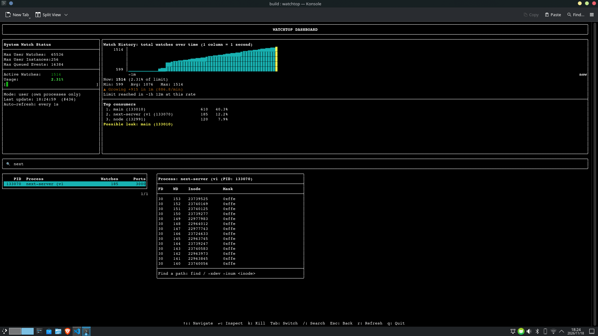
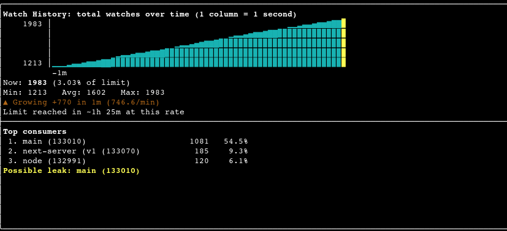
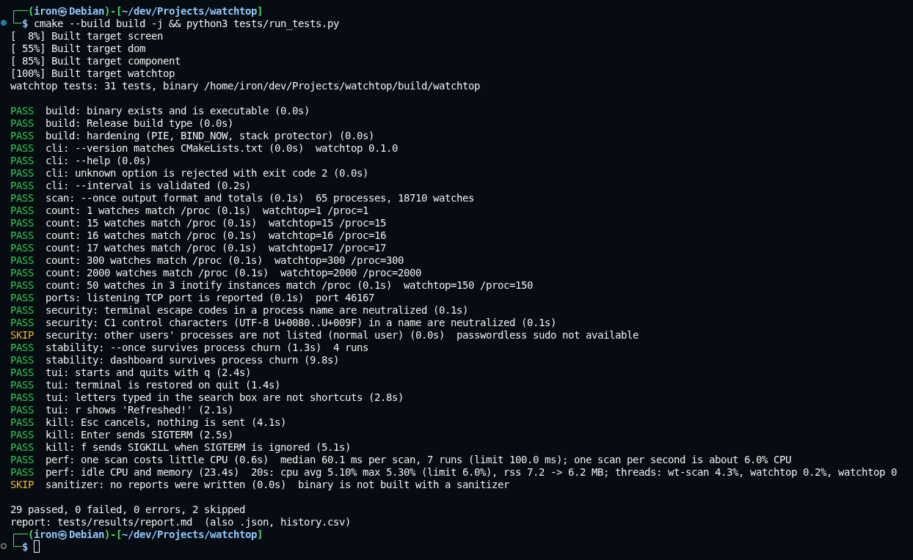

<p align="center">
  
</p>

<h1 align="center">watchtop</h1>

<p align="center">
  <b>Who is using up your file watchers?</b><br>
  Find out in seconds, and fix <i>"System limit for number of file watchers reached"</i>.
</p>

<p align="center">
  
  
  
  
</p>

**watchtop** is a Linux terminal tool that shows which programs are using up your file watchers.

Your editor, your dev server and your sync apps all ask Linux to tell them when a file changes. Each request is called a **watch**, and Linux only allows so many of them. When the limit is reached, apps crash or stop reloading, and the error does not say who is responsible.

watchtop shows you **who** is using the watches, **whether the number keeps growing**, and lets you **stop the culprit safely**, all in one live dashboard.



---

## Table of Contents
- [Why watchtop?](#why-watchtop)
- [How it works](#how-it-works)
- [Features](#features)
- [Installation](#installation)
- [How to use it](#how-to-use-it)
- [Keyboard controls](#keyboard-controls)
- [Stopping a process (safely)](#stopping-a-process-safely)
- [Security and safety](#security-and-safety)
- [Tests](#tests)
- [Known limitations](#known-limitations)
- [Contributing](#contributing)
- [License](#license)

---

## Why watchtop?

**inotify** is the Linux feature that lets programs ask: *"tell me when this file or folder changes."* Each request is a **watch**, and the kernel limits how many watches one user can have:

```
/proc/sys/fs/inotify/max_user_watches
```

Dev tools use many watches: VS Code, Vite, webpack, Next.js, nodemon, Syncthing, Dropbox and build systems. When the limit is reached, apps crash, fail to start, or silently stop reloading files, and the error message does not say **who** is using the watches.

watchtop answers three questions:
- **Who** is using my watches?
- **Is it growing** (a possible leak), and **when will I hit the limit**?
- **Which port** does that process hold, so I can free it?

> Think of a watch as a security camera pointed at one file or folder.
> watchtop shows who installed how many cameras.

---

## How it works

watchtop only **reads** from the `/proc` folder, the information Linux already publishes about running processes:

1. It lists every process in `/proc`.
2. It finds the file descriptors of each process that are inotify instances.
3. It counts the `inotify wd:` lines in `/proc/<pid>/fdinfo/<fd>`. Each line is one watch.
4. It finds listening TCP ports by matching the process's sockets with `/proc/net/tcp` and `/proc/net/tcp6`.
5. It refreshes every 2 seconds (change it with `--interval`) and tracks how the total changes over time.

It is **not** a file-event monitor like `inotifywait`. It does not watch your files. It audits the watches that already exist.

---

## Features

- **System status**: the kernel limits, active watches, and usage in % with a color gauge (green, yellow above 60%, red above 80%)
- **Watch history graph**: the last 60 refreshes (2 minutes at the default interval), with a scale, min / average / max, trend, and an estimate of **when the limit will be reached**
- **Top consumers**: the 3 heaviest processes with their share of the total
- **Leak detection**: highlights processes whose watch count keeps growing and never drops
- **Process table**: PID, name, watch count and listening ports
- **Search**: filter by PID, process name or port while you type
- **Details panel**: fd, watch id, inode and event mask of each watch
- **Stop a process**: press `k`, confirm, and free a port (see below)
- **Refresh indicator**: a clear sign when you press `r`
- **Low CPU use**: about 5% at the default 2 second refresh on a machine with 65 processes and 18,700 watches. Reading `/proc` is mostly kernel time, so a longer `--interval` means less CPU
- **Command line options**: `--interval`, `--once` (one plain-text report, good for scripts), `--version` and `--help`




---

## Installation

### Requirements
- Linux (a kernel with `/proc`)
- A C++20 compiler (GCC 10+ or Clang 14+)
- CMake 3.16 or newer
- Python 3, only if you want to run the tests
- Git and internet access on the first build (the UI library FTXUI is downloaded automatically)

### Build from source

```bash
git clone https://github.com/Abdev314/watchtop.git
cd watchtop
cmake -S . -B build
cmake --build build -j
./build/watchtop
```

Optional system-wide install:

```bash
sudo cmake --install build
```

The default build type is **Release** (optimized and hardened, see [Security and safety](#security-and-safety)).

### Pre-built binaries
*Coming soon.*

---

## How to use it

Start it from a terminal. A window of at least **120 columns by 60 rows** is recommended:

```bash
./build/watchtop
```

**Normal user:** you see your own processes. This is enough for most developers.

**With `sudo`:** you also see other users' processes, and the total counts all users. Run it as a normal user unless you need this.

### Options

| Option | What it does |
|--------|--------------|
| `--interval N` | Seconds between refreshes, 1 to 60 (default 2). A longer interval uses less CPU |
| `--once` | Print one plain-text report and exit. Useful in scripts |
| `--version` | Print the version |
| `-h`, `--help` | Show the help |

The `--once` report has a few header lines, then one tab-separated line per process (PID, name, watches, ports):

```
#watchtop 0.1.0
max_user_watches=65536
total_watches=18710
processes=65
```

### Example: "port 3000 is already in use"

1. Press `/`, type `3000`, then press `Esc`. The table shows the process that holds the port.
2. Check the name and PID, then press `k`.
3. Press `Enter` to ask it to stop politely.
4. If it is still listed, press `k`, then `f` to force it.


### Example: "which app is using all my watches?"

Look at **Top consumers** (top right), or leave the search empty and read the Watches column. A yellow row with **Possible leak** means its count keeps growing.

---

## Keyboard controls

| Key | Action |
|-----|--------|
| `↑` / `↓` | Move in the process list |
| `Enter` | Show the watches of the selected process |
| `/` | Go to the search box |
| `Tab` | Switch between the search box and the table |
| `Esc` or `Enter` (in search) | Return to the table |
| `k` | Stop the selected process (asks for confirmation) |
| `r` | Refresh now (shows "Refreshing..." and then "Refreshed!") |
| `q` | Quit |

While you type in the search box, letters such as `q`, `r` and `k` are just text. The shortcuts work only when the table is focused.

---

## Stopping a process (safely)

Press `k` on a selected process to open a confirmation box with its name, PID, ports and watch count.

| Key in the box | What it does |
|----------------|--------------|
| `Enter` or `y` | **SIGTERM**: asks the process to stop and clean up (recommended first) |
| `f` | **SIGKILL**: force kill, no cleanup (use if SIGTERM was ignored) |
| `Esc` or `n` | Cancel, nothing is sent |


Protections:
- Nothing is sent on a single key press, there is always a confirmation.
- The process **start time** is checked before sending and again after pinning the process with `pidfd_open`. If the PID was reused by a different process, **nothing is sent**.
- watchtop refuses to signal PID 1 or itself.
- Other users' processes are refused unless you run as root.
- The result of the action is shown in the bottom line.

---

## Security and safety

watchtop is a diagnostic tool, so it is designed to do as little as possible.

**What it does**
- Reads files under `/proc` (read-only).
- Sends a signal **only** when you confirm it in the dialog.

**What it does not do**
- It has no shell, no command execution, and no network access. An earlier version had a built-in command panel, which was **removed** because it became a root shell under `sudo`.
- It does not write files, change kernel settings, or need root for normal use.

**Hardening in this version**
- **Terminal escape protection:** process names are chosen by their owner, so control characters (including the UTF-8 form of C1 controls, U+0080 to U+009F) are replaced with `?` before display. Another user cannot clear your screen or change your window title by naming a process.
- **No crashes from `/proc` changes:** processes that exit while scanning are skipped, and number parsing never throws.
- **No data race:** a background thread reads `/proc` and sends finished data to the UI thread. Only the UI thread touches the screen data.
- **Bounded work:** the details list draws at most 500 rows, even if a process owns 100,000+ watches.
- **Hardened build:** Release by default, `-fstack-protector-strong`, `-fstack-clash-protection`, `-D_FORTIFY_SOURCE=2`, PIE, full RELRO and `BIND_NOW`, and warnings enabled (`-Wall -Wextra -Wpedantic -Wshadow`).

**Reporting a problem**
If you find a security issue, please open a GitHub issue. For a serious vulnerability, contact the maintainer privately first.

---

## Tests

watchtop has an automated test suite. It needs only Python 3 (standard library) and a built binary, and takes about a minute and a half:

```bash
python3 tests/run_tests.py
```



Each test ends as **PASS**, **FAIL**, **ERROR** (the test itself crashed) or **SKIP** (it cannot run on this machine). The results are saved in `tests/results/`: `report.md` (the table), `report.json` and `history.csv`. The report names the commit and marks uncommitted changes.

**What the 31 tests check**

| Group | What it checks |
|-------|----------------|
| Build | The binary exists, the build type is Release, and the binary has PIE, `BIND_NOW` and a stack protector |
| Command line | `--version` matches `CMakeLists.txt`, `--help` works, unknown options are rejected, `--interval` accepts 1 to 60 only |
| Accuracy | The watch count equals the real count from `/proc` for 1, 15, 16, 17, 300 and 2000 watches, and for 3 inotify instances in one process |
| Ports | A listening TCP port is reported for its process |
| Security | Escape codes and C1 control characters in a process name are neutralized. A normal user cannot see another user's process |
| Stability | `--once` and the dashboard both survive 300 short-lived processes, in 3 rounds |
| Dashboard | Starts and quits with `q`, restores the terminal, letters typed in search are not shortcuts, `r` shows "Refreshed!" |
| Kill | `Esc` cancels, `Enter` sends exactly SIGTERM, `f` sends exactly SIGKILL when SIGTERM is ignored |
| Performance | CPU cost of one scan, and idle CPU and memory over 20 seconds |
| Sanitizers | No AddressSanitizer, UBSan or ThreadSanitizer report was written (for sanitizer builds) |

**Latest result:** Debian 13 (trixie), GCC 14.2, normal user, physical machine. **29 passed, 0 failed, 2 skipped.** The skipped tests need passwordless `sudo` and a sanitizer build.

| Measured | Result |
|----------|--------|
| Watch counts on a real machine (65 processes, 18,710 watches) | Exact, equal to `/proc` |
| Idle CPU at the default 2 second interval | 5.1% average, 5.3% peak |
| Memory over 20 seconds | About 6 to 9 MB, no growth |
| One scan | About 60 ms of CPU |

Useful options: `--list`, `--only kill,count`, `--skip perf`, `--long 1800` (a 30 minute CPU and memory run), and `--bin build-asan/watchtop --label asan` (run the same tests against another build).

**Still to verify** (this list will shrink as the tests are run):
- [ ] AddressSanitizer, UBSan and ThreadSanitizer builds
- [ ] Ubuntu, Fedora and Arch
- [ ] Docker and other containers

---

## Known limitations

- **Only processes that use inotify are listed.** A server that watches no files will not appear, so you cannot stop it from watchtop.
- **The details panel does not show file paths.** The kernel does not publish them in `/proc`. watchtop shows the inode, and you can find the file with `find / -xdev -inum <inode>`.
- **Only TCP listening ports** are shown (not UDP).
- **The kernel limit is per user.** When you run as root, watchtop adds up all users, so that number is not compared against a single user's limit.
- **Processes that share an inotify instance** (for example after `fork`) may each report its watches, so the total can be higher than the kernel's real count.
- **Containers:** not tested yet. Inside a container, `/proc` normally shows only the container's own processes.
- **Terminal size:** needs a large terminal, about 120 columns by 60 rows.
- **Leak detection needs time:** about 20 seconds of data at the default interval.
- **Early software:** tested on Debian only so far.

---


## Contributing

Contributions are welcome. Please open an issue to discuss a change before sending a pull request.

1. Fork the repository
2. Create a feature branch
3. Build with `-Wall -Wextra` and make sure there are no warnings
4. Run `python3 tests/run_tests.py` and make sure nothing fails
5. Open a pull request

---

## License

Distributed under the [MIT License](LICENSE). See the `LICENSE` file for details.
---

<p align="center">Made for Linux developers</p>